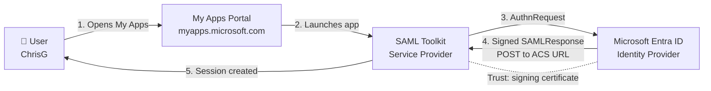
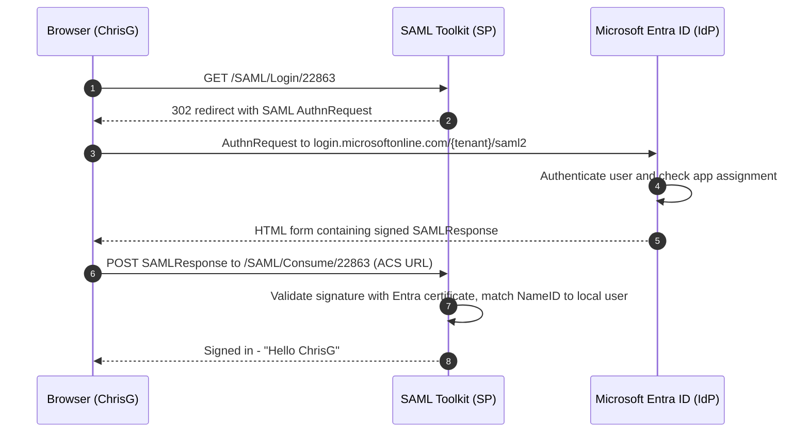

# Project 3 — Single Sign-On & Federation (SAML · OIDC ·)

**Azure Cloud Lab Series · Project 3 of 6 · Omokorede Oludairo**

---

## 📌 Overview

This project configures **SAML 2.0 federation** between **Microsoft Entra ID** (Identity Provider) and a SaaS application (Service Provider). The SP is the **Microsoft Entra SAML Toolkit**, a Microsoft-hosted SAML test application. The project then extends to **OIDC/OAuth2** and **SCIM provisioning** so the three core enterprise identity protocols can be compared side by side.

The SAML phase demonstrates:

- Adding a pre-integrated application from the **Microsoft Entra App Gallery**
- Establishing **two-way trust** between IdP and SP: metadata exchange, signing certificate, Entity ID and ACS URL
- **Assignment-based access control**: only assigned users can launch the app
- An end-to-end **SP-initiated SSO flow** launched from the My Apps portal

### Why this matters in an enterprise

| Protocol | What it does | Typical enterprise use |
|---|---|---|
| **SAML 2.0** | XML-based **authentication** — the IdP issues a signed assertion to the SP | Established SaaS (Salesforce, ServiceNow, Workday, AWS), legacy web apps |
| **OIDC / OAuth 2.0** | JSON/JWT-based **authentication (OIDC)** and **delegated authorisation (OAuth)** | Modern web, mobile and SPA apps, APIs, microservices |

> SAML and OIDC answer *"who is this user?"* at sign-in. Mature IAM programmes use both.

---

## 🧪 Lab Environment

| Component | Detail |
|---|---|
| Identity Provider | Microsoft Entra ID (P2) — tenant `Mocktest909.onmicrosoft.com`, custom domain `cloudidlab.net` |
| Service Provider | Microsoft Entra SAML Toolkit — `https://samltoolkit.azurewebsites.net` |
| Test user | `ChrisG@Mocktest909.onmicrosoft.com` (cloud-only) |
| Admin account | `korede@cloudidlab.net` |
| Hybrid foundation | `corp.local` AD synced via Microsoft Entra Connect (Projects 1 & 2) |
| Cost | £0 — gallery app and Toolkit are free; P2 licence already in place |

---

## 🏗️ Architecture

### SP-initiated SAML flow

---

## 🔑 Configuration Reference

| Setting | Value | Where it is set |
|---|---|---|
| Identifier (Entity ID) | `https://samltoolkit.azurewebsites.net` | Entra → Basic SAML Configuration |
| Reply URL (ACS URL) | `https://samltoolkit.azurewebsites.net/SAML/Consume/22863` | Entra → Basic SAML Configuration |
| Sign on URL | `https://samltoolkit.azurewebsites.net/SAML/Login/22863` | Entra → Basic SAML Configuration |
| Login URL | `https://login.microsoftonline.com/{tenant-id}/saml2` | Toolkit → SAML Configuration |
| Logout URL | `https://login.microsoftonline.com/{tenant-id}/saml2` | Toolkit → SAML Configuration |
| Microsoft Entra Identifier | `https://sts.windows.net/{tenant-id}/` | Toolkit → SAML Configuration |
| Signing certificate | Certificate (Raw), SHA-256, *Sign SAML assertion* | Downloaded from Entra → uploaded to Toolkit |
| Connection ID | `22863` | Generated by the Toolkit |

**Default claims issued by Entra ID:**

| Claim | Source attribute |
|---|---|
| Unique User Identifier (NameID) | `user.userprincipalname` |
| name | `user.userprincipalname` |
| emailaddress | `user.mail` |
| givenname | `user.givenname` |
| surname | `user.surname` |

> The Toolkit matches the incoming **NameID** against its registered users by email address, so the Toolkit account must be registered with the same value as the user's UPN.

---

## Phase 3 — Register the Enterprise Application

### Step 3.1 — Add the SAML Toolkit from the App Gallery

1. In the **Microsoft Entra admin center**, go to **Entra ID → Enterprise apps → + New application**.
2. Search for **toolkit** and select **Microsoft Entra SAML Toolkit** (publisher: Microsoft Corporation).
3. Review the details panel, then click **Create**.

> 💡 The details panel shows **"Automatic provisioning is not supported"**. This application cannot be used for SCIM.

### Step 3.2 — Review the application Overview

Once created, the app opens on its **Overview** page, showing the **Application ID** and **Object ID** and the *Getting Started* tiles.

---

## Phase 4 — Configure SAML-Based SSO

### Step 4.1 — Select SAML as the sign-on method

**Enterprise apps → Microsoft Entra SAML Toolkit → Single sign-on → SAML**

### Step 4.2 — Review the empty Basic SAML Configuration

Before configuration, the **Identifier**, **Reply URL** and **Sign on URL** fields are all flagged **Required**. The Toolkit generates the ACS and Sign-on URLs (Step 4.5), so these fields are completed last (Step 4.6).

### Step 4.3 — Record the Entra ID (IdP) endpoints

Section **4 — Set up Microsoft Entra SAML Toolkit** shows the three values the SP needs in order to trust Entra ID:

- **Login URL**
- **Microsoft Entra Identifier**
- **Logout URL**

### Step 4.4 — Download the SAML signing certificate

1. In section **3 — SAML Certificates**, open the certificate options.
2. Confirm **Signing Option = Sign SAML assertion** and **Signing Algorithm = SHA-256**.
3. Download **Certificate (Raw)**, which saves as `Microsoft Entra SAML Toolkit.cer`.

> 🔐 The SP uses this certificate to verify that each SAML assertion was really issued by Entra ID and was not changed in transit. Note the **thumbprint**, because it is the quickest way to confirm that both sides hold the same certificate.

### Step 4.5 — Configure the Service Provider (SAML Toolkit)

1. Browse to `https://samltoolkit.azurewebsites.net`, click **Register**, and create a local account whose email **matches the Entra user's UPN** (`ChrisG@Mocktest909.onmicrosoft.com`).
2. Log in with that account.

3. Go to **SAML Configuration → Create** and enter the values from Steps 4.3 and 4.4:
   - **Login URL** and **Logout URL**: the Entra Login URL
   - **Certificate RAW**: upload the `.cer` file
   - **Azure AD Identifier**: the Microsoft Entra Identifier
4. Click **Save**.

5. The Toolkit generates a unique **Connection Identifier (22863)** and shows the **SP-initiated Login URL** and **ACS URL** for this connection.

### Step 4.6 — Complete the Basic SAML Configuration in Entra ID

Return to Entra ID → **Basic SAML Configuration → Edit** and enter:

| Field | Value |
|---|---|
| Identifier (Entity ID) | `https://samltoolkit.azurewebsites.net` |
| Reply URL (ACS URL) | `https://samltoolkit.azurewebsites.net/SAML/Consume/22863` |
| Sign on URL | `https://samltoolkit.azurewebsites.net/SAML/Login/22863` |

Click **Save**.

> ⚠️ The connection ID (`/22863`) must be on **both** URLs. Without it, the Toolkit cannot tell which SAML configuration to use, and the assertion is rejected.

---

## Phase 5 — Assign Users

### Step 5.1 — Assign the test user to the application

1. **Enterprise apps → Microsoft Entra SAML Toolkit → Users and groups → + Add user/group**.
2. Search for and select **ChrisG**, click **Select**, then **Assign**.

> 🛡️ **Least privilege:** Entra ID only issues a SAML assertion for users or groups assigned to the app. An unassigned user gets an `AADSTS50105` error. In production, assign **groups** rather than individuals so that access follows group membership.

---

## Phase 6 — Test the End-to-End SSO Flow

All testing is done in an **InPrivate / Incognito** window, so that no cached session hides the real flow.

### Step 6.1 — Launch the app from My Apps

Sign in to `https://myapps.microsoft.com` as **ChrisG**. The **Microsoft Entra SAML Toolkit** tile appears because of the assignment made in Step 5.1.

### Step 6.2 — Start the SP-initiated login

Clicking the tile opens the Toolkit's **SAMLLogin** page for **Connection Identifier 22863**. Clicking **Log in** makes the SP issue a SAML **AuthnRequest** to Entra ID.

### Step 6.3 — Signed in through SAML

Entra ID authenticates the user and POSTs a signed **SAMLResponse** to the ACS URL. The Toolkit validates the signature, matches the NameID, and signs the user in. The page shows **"Hello ChrisG@Mocktest909.onmicrosoft.com!"**, and no Toolkit password was entered.

### Step 6.4 — Validate in the Entra ID sign-in logs

1. Go to **Entra ID → Monitoring & health → Sign-in logs**.
2. Filter by **User contains `chris`** with **Date range: Last 7 days**, on the **User sign-ins (interactive)** tab.
3. The highlighted entries show **chrisg@mocktest909.onmicrosoft.com** signing in to **Microsoft Entra SAML Toolkit** with **Status: Success**, preceded by the **My Apps** sign-in that launched the app.

> 📋 **Audit value:** each entry carries a unique **Request ID**, a UTC timestamp, the application and the outcome. Entra ID P2 adds authentication details and Conditional Access evaluation for each sign-in. Together these give an auditor a record of who accessed which application, and when, without relying on the SaaS app's own logs.

---

## 🛠️ Troubleshooting

| Symptom | Likely cause | Fix |
|---|---|---|
| `AADSTS50105` — user not assigned | User or group not assigned to the app | Add the assignment under **Users and groups** |
| `AADSTS700016` — application not found | Identifier (Entity ID) mismatch | Set the Identifier to exactly `https://samltoolkit.azurewebsites.net` |
| `AADSTS50011` — reply URL mismatch | ACS URL missing the connection ID | Use `/SAML/Consume/22863` in the Reply URL |
| SP rejects the assertion (signature invalid) | Toolkit holds a different or old certificate | Compare thumbprints; re-download **Certificate (Raw)** and re-upload it to the Toolkit |
| Signed in to Entra but not to the app | NameID doesn't match a registered Toolkit user | Register the Toolkit account with the user's exact UPN |
| Old session hides the flow | Cached browser session | Test in a fresh InPrivate window |

---

## 💡 Key Learnings

- **Trust is two-way.** The IdP has to know the SP (Entity ID and ACS URL), and the SP has to know the IdP (Login URL, Identifier and certificate). A mismatch on either side breaks SSO.
- **The certificate is the root of trust.** If the SP holds a stale certificate, sign-ins fail. Production apps need certificate expiry monitoring (Entra sends notification emails to the address configured in the signing certificate panel).
- **The NameID connects the two accounts.** A UPN vs email mismatch is one of the most common causes of SAML failure in production.
- **Assignment is access control.** Requiring assignment means SSO enforces least privilege rather than simply passing everyone through.
- **SAML is not provisioning.** The Toolkit still needed a manually registered account. SCIM removes that manual step, which is why it comes next in this project.

---

## ✅ Progress Checklist

**SAML federation**
- [x] Microsoft Entra SAML Toolkit added from the App Gallery
- [x] SAML selected as the single sign-on method
- [x] IdP endpoints recorded and signing certificate (Raw) downloaded
- [x] Toolkit account registered and SAML configuration created (Connection ID 22863)
- [x] Basic SAML Configuration completed in Entra ID
- [x] Test user assigned to the application
- [x] SP-initiated SSO tested from My Apps
- [x] Successful SAML sign-ins validated in the Entra ID sign-in logs

---

*Azure Cloud Lab Series · Project 3 · Omokorede Oludairo*
*Previous: [Project 2 — Hybrid Identity Integration](../Project-2-Hybrid-Identity-Integration)
