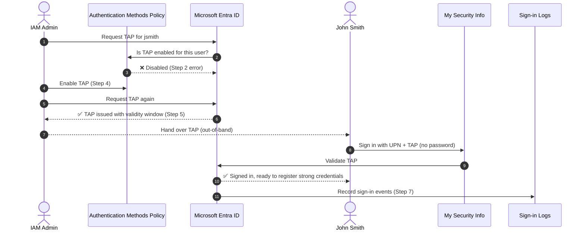

 
> Part of the **Azure Cloud Lab Series**, a hands-on Microsoft Entra ID portfolio that shows enterprise IAM engineering skills.
> Tenant: `cloudidlab.net` (Mock Test) · Licence: Microsoft Entra ID P2
 
---
 
## 📌 Overview
 
A **Temporary Access Pass (TAP)** is a time-limited passcode issued by an administrator in Microsoft Entra ID. While it's valid, the user can sign in **without a password** and register strong, phishing-resistant credentials such as Microsoft Authenticator or a passkey.
 
Organisations use TAP to solve two common problems:
 
| Problem | How TAP solves it |
|---|---|
| **Day-one onboarding:** how does a new starter sign in for the first time without IT emailing a password? | IT issues a short-lived TAP and the user registers passwordless methods straight away. A password is never handed over. |
| **Account recovery:** a user loses the phone that holds their MFA method. | The helpdesk verifies the user and issues a TAP, and the user re-registers a new authenticator. |
 
This project shows the **end-to-end TAP lifecycle** in a live tenant: enabling the method at policy level, issuing a pass to a hybrid (synced) user, signing in with it, and checking the result in the Entra sign-in logs. It also documents the **misconfiguration risks** found along the way and maps each control to **NIST, ISO/IEC 27001:2022 and UK GDPR**.
 
---
 
## 🎯 Objectives
 
- Understand how the **Authentication methods policy** controls which credentials can be issued
- Troubleshoot a real policy-enforcement error when issuing a TAP
- Enable and issue a Temporary Access Pass to a synced hybrid identity
- Sign in as the end user with the TAP (no password)
- Confirm the activity through **Sign-in logs** as audit evidence
- Assess the configuration against compliance frameworks and recommend hardening
---
 
## 🧪 Lab Environment
 
| Component | Detail |
|---|---|
| Tenant | Mock Test — `cloudidlab.net` |
| Admin account | `korede@cloudidlab.net` |
| Test user | **John Smith** (`jsmith@cloudidlab.net`), a hybrid identity synced from on-prem `corp.local` via Microsoft Entra Connect ([Project 2](../Project-2-Hybrid-Identity-Integration)) |
| Portal | Microsoft Entra admin center |
| User portal | My Security Info — `https://aka.ms/mysecurityinfo` |
| Cost | £0 (no Azure resources are deployed; Entra ID configuration only) |
 
---
 
## 🔄 How the TAP Flow Works
 

 
---
 
## 🛠️ Implementation Steps
 
### Step 1: Attempt to issue a TAP to John Smith
 
**Path:** Entra ID → **Users** → John Smith → **Authentication methods** → **+ Add authentication method** → choose **Temporary Access Pass**
 
John Smith starts with **no registered authentication methods**. The Add authentication method blade is set to *Temporary Access Pass*, with a 1-hour activation duration and one-time use left at the default **No**.
 
 
---
 
### Step 2: Issuance blocked by policy
 
Clicking **Add** returns the error below:
 
> *Unable to add Temporary Access Pass. Converged UserCredentialPolicy does not allow creating or updating this authentication method. AuthMethodType [TemporaryAccessPass].*
 

 
**🔍 Root cause:** Entra ID uses a **converged Authentication methods policy**. An administrator can't issue a credential type unless that method is enabled for the user in the tenant policy. This is a **preventive control**: per-user admin actions can't get around tenant-wide policy.
 
---
 
### Step 3: Inspect the Authentication methods policy
 
**Path:** Entra ID → **Authentication methods** → **Policies**
 
The policy list confirms that **Temporary Access Pass is disabled (Enabled = No)**. The current tenant baseline is also recorded here for the compliance review below:
 
| Method | Target | Enabled |
|---|---|---|
| Passkey (FIDO2) | — | No |
| Microsoft Authenticator | All users | Yes |
| SMS | 1 group | Yes |
| **Temporary Access Pass** | — | **No** |
| Software OATH tokens | All users | Yes |
| Email OTP | — | Yes |
 

 
---
 
### Step 4: Enable the Temporary Access Pass policy
 
**Path:** Authentication methods → Policies → **Temporary Access Pass** → **Enable** → Target: **All users** → **Save**
 
The portal confirms *"The policy was successfully saved"*, and TAP now shows **All users · Yes**.
 
The portal also shows a banner saying **passkey auto-enablement** will apply to this tenant: users enabled for SMS or voice will be moved onto a Microsoft-managed passkey profile. This reflects Microsoft's wider move away from phone-based authenticators towards phishing-resistant ones.
 

 
> ⚠️ Targeting **All users** was used here to get the first run working. It's flagged as a finding in the [Security Observations](#-security-observations--recommended-hardening) section.
 
---
 
### Step 5: Issue the TAP
 
**Path:** Users → John Smith → Authentication methods → **+ Add authentication method** → Temporary Access Pass → **Add**
 
This time the TAP is issued successfully. The portal shows the pass **once only**, along with the registration link (`https://aka.ms/mysecurityinfo`) and its validity window:
 
| Field | Value |
|---|---|
| Valid from | 01/11/2026 19:25:16 |
| Valid until | 02/11/2026 00:25:16 (**5 hours**) |
| One-time use | No (reusable within the window) |
 
**Temporary Access Pass** now appears under John Smith's *Usable authentication methods*.
 

 
> 🔒 The pass value has been **redacted** in the published screenshot. It has also expired.
 
---
 
### Step 6: User signs in with the TAP
 
**Path (as the user, in an InPrivate window):** `https://aka.ms/mysecurityinfo` → enter `jsmith@cloudidlab.net`
 
Entra ID detects an active TAP and goes **straight to the "Enter Temporary Access Pass" prompt**, without asking for a password. The password is only offered as a fallback link (*"Use your password instead"*), which shows that an active TAP takes priority in the sign-in experience.
 

 
---
 
### Step 7: Check the sign-in in the Entra sign-in logs
 
**Path:** Entra ID → **Monitoring & health** → **Sign-in logs** → filter *User principal name contains jsmith*, Date range = Last 24 hours
 
The logs show John Smith's interactive sign-ins to **My Signins** and **My Profile** (resource: Microsoft Graph) between **19:33Z and 19:43Z**, all inside the TAP validity window. The final sign-in at **19:43:40Z** has a **Success** status.
 
The **Interrupted** entries are normal. They record points where Entra paused the sign-in for an extra prompt (for example, security info registration or "Stay signed in?"), and each was followed by a successful sign-in.
 

 
> 💡 To see which credential was used for each event, open a log entry → **Authentication Details** tab. That tab shows *Temporary Access Pass* as the method.
 
---
 
### Step 8: User overview and reporting delay
 
**Path:** Users → John Smith → **Overview** → *My Feed* → Sign-ins
 
Although the sign-in logs show successful sign-ins, the user overview still shows **Last interactive sign-in: -- --**. This tile is filled from a separate activity property that **updates later than the sign-in logs**, so it can stay blank for some time after the first sign-in.
 

 
> 📝 **Lesson:** For audit or investigation work, use the **sign-in logs** as the source of truth, not summary tiles on the user object.
 
---
 
## 🧯 Troubleshooting Log
 
| # | Symptom | Root cause | Resolution |
|---|---|---|---|
| 1 | *"Converged UserCredentialPolicy does not allow creating or updating this authentication method"* when adding a TAP | TAP was disabled in the tenant Authentication methods policy | Enabled TAP under Authentication methods → Policies (Step 4) |
| 2 | Issued TAP valid for 5 hours, even though the blade showed 1 hour | The issued lifetime comes from the activation duration chosen at creation, within the policy's min/max limits | Confirm the duration before clicking Add; set a 1-hour **default** in the policy (see Recommendation 2) |
| 3 | User overview shows no last sign-in after a successful sign-in | The summary property updates later than the sign-in logs | Check activity in Monitoring → Sign-in logs |
| 4 | "Interrupted" entries in the sign-in log | Entra paused the sign-in for an extra prompt (registration / Stay signed in) | Expected behaviour; each one is followed by a Success entry |
 
---
 
## 🛡️ Security Observations & Recommended Hardening
 
The first run proved the TAP flow works, but a review of the configuration found the following gaps. In a production tenant, these would be fixed before rollout:
 
| # | Observation (evidence) | Risk | Recommendation |
|---|---|---|---|
| 1 | TAP targeted at **All users** (Step 4) | Any account, including privileged admins, could be issued a pass, which widens the attack surface | Scope TAP to a dedicated group, e.g. `SG-TAP-Onboarding`, containing only new starters and recovery cases |
| 2 | **Reusable** TAP with a **5-hour** lifetime (Step 5) | A reusable, long-lived pass behaves like a temporary password and can be replayed if intercepted | Enforce **one-time use = Yes** and a **1-hour default lifetime** in the TAP policy's *Configure* tab |
| 3 | TAP displayed in clear text on screen (Steps 5–6) | The pass could be exposed through screenshots, screen sharing or shoulder surfing | Redact it in all documentation; deliver the TAP **out-of-band** (in person or by phone after identity verification), never on the same channel as the username |
| 4 | **SMS** and **Email OTP** enabled in the tenant baseline (Step 3) | These are phishable, weaker authenticators | Phase out SMS/voice in favour of Authenticator and passkeys; limit Email OTP to guest/B2B scenarios |
| 5 | **Passkey (FIDO2)** disabled (Step 3) | TAP's purpose is to bootstrap strong credentials, but no phishing-resistant method was available to register | Enable passkeys for the TAP group so the onboarding ends in a phishing-resistant credential |
| 6 | Issuance carried out by a highly privileged admin account | Breaks least privilege for routine helpdesk work | Delegate TAP issuance to the **Authentication Administrator** role, ideally made eligible through PIM (covered in Project 5) |
 
---
 
## 📜 Compliance Mapping
 
Each step and finding is mapped below to the frameworks a security or audit reviewer would assess it against.
 
### NIST SP 800-63B: Digital Identity Guidelines (Authentication)
 
| Principle | How this project addresses it |
|---|---|
| **Authenticator binding**: verify the subscriber before binding a new authenticator | TAP is a controlled, admin-issued bootstrap credential used only to register a stronger authenticator |
| **Short-lived temporary secrets** | TAP has a fixed validity window; Recommendation 2 tightens it to one-time use and 1 hour |
| **Phishing resistance** | Recommendation 5 ensures onboarding ends with a passkey, the type of authenticator NIST requires at higher assurance levels |
| **Restricted authenticators** (SMS/PSTN) and email not suitable as an authenticator | Recommendation 4 phases these methods out of the tenant baseline |
 
### NIST SP 800-53 Rev. 5: Security & Privacy Controls
 
| Control | Evidence |
|---|---|
| **IA-2** Identification & Authentication | Step 6: user authenticated with a TAP linked to their own identity |
| **IA-5** Authenticator Management | Steps 2–5: issuance governed by policy, lifetime enforced; Recommendations 2–3 |
| **AC-2** Account Management | Step 1: the credential is issued against a managed, synced identity |
| **AC-6** Least Privilege | Recommendations 1 and 6 (group scoping, delegated role) |
| **AU-2 / AU-6** Event Logging & Review | Step 7: sign-in events captured and reviewed |
 
### ISO/IEC 27001:2022, Annex A
 
| Control | Evidence |
|---|---|
| **A.5.15** Access control | Step 2: tenant policy blocks credential types that haven't been approved |
| **A.5.16** Identity management | Step 1: TAP issued to a lifecycle-managed hybrid identity |
| **A.5.17** Authentication information | Steps 5–6 and Recommendation 3: temporary credentials issued securely, time-limited and delivered out-of-band |
| **A.8.5** Secure authentication | Steps 4–6: passwordless sign-in path; Recommendation 5 |
| **A.8.15** Logging | Step 7: sign-in logs record each event with timestamp and request ID |
| **A.8.16** Monitoring activities | Step 8 lesson: monitoring relies on authoritative log sources |
 
### UK GDPR
 
| Article | How this project supports it |
|---|---|
| **Art. 5(1)(f)** Integrity & confidentiality | No password is ever sent by email, which removes a common route to credential exposure |
| **Art. 25** Data protection by design & by default | Recommendations 1–2 make the secure configuration the default, not the exception |
| **Art. 32** Security of processing | Strong, phishing-resistant authentication protects accounts that can reach personal data |
| **Art. 5(2)** Accountability | Step 7: logs show who authenticated, when and how, as evidence for audit |
 
---
 
## 🧹 Cleanup
 
To keep the tenant tidy and follow least privilege after the lab:
 
1. Users → John Smith → Authentication methods → **delete the (expired) Temporary Access Pass**
2. Authentication methods → Policies → Temporary Access Pass → set **Enable = No** (or apply Recommendations 1–2 if you'll keep using it)
3. No Azure compute was used, so there's no ongoing cost. DC1/CLIENT1 aren't needed and stay deallocated.
---
 
## ✅ Completion Checklist
 
- [x] Reproduced and diagnosed the policy-enforcement error on TAP issuance
- [x] Reviewed the tenant Authentication methods baseline
- [x] Enabled the Temporary Access Pass method
- [x] Issued a TAP to a synced hybrid user
- [x] Signed in as the end user with the TAP (no password)
- [x] Verified the activity in Entra sign-in logs
- [x] Documented reporting-delay behaviour on the user object
- [x] Produced security findings and hardening recommendations
- [x] Mapped controls to NIST SP 800-63B, NIST SP 800-53, ISO/IEC 27001:2022 and UK GDPR
- [x] Cleaned up
---
 
## 🧠 Skills Demonstrated
 
`Microsoft Entra ID` · `Authentication Methods Policy` · `Temporary Access Pass` · `Passwordless Onboarding` · `Hybrid Identity` · `Sign-in Log Analysis` · `Troubleshooting` · `Least Privilege` · `NIST SP 800-63B` · `NIST SP 800-53` · `ISO/IEC 27001:2022` · `UK GDPR`
